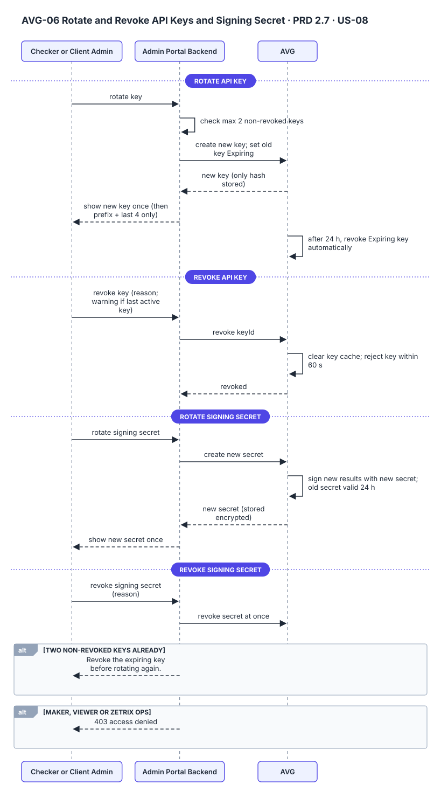

# API Keys and Signing Secret

The API key is how AVG knows which service is calling; the signing secret is how the service checks AVG's results. Both must be replaceable without downtime and blockable in an emergency.

## **Who**

Checker and Client Admin for their own company's services. Super Admin for any service.

## **Key List**

Shows key ID, prefix and last 4 characters, status (`Active` / `Expiring` / `Revoked`), created date, created by and last used time.

## **Actions**

| Action | Effect |
| --- | --- |
| Rotate key | Creates a new key (shown once) and sets the old key to `Expiring`. The expiring key works for 24 hours, then is revoked automatically. |
| Revoke key | Stops the key at once; AVG rejects it within 60 seconds. Reason mandatory. |
| Rotate secret | Creates a new secret (shown once). AVG signs with the new one; the old one stays valid for 24 hours. |
| Revoke secret | Stops the secret at once. |

## **Rules**

| Rule | Detail |
| --- | --- |
| Maximum keys | 2 non-revoked keys per service. |
| Last key | Revoking the only active key shows a warning that the service will stop working until a new key is created; revoked only after confirmation. |
| Storage | Only a hash of the key is stored. Full key never logged or shown again. |
| No fresh 2FA | Rotating or revoking does not ask for an extra authenticator code. |

## **Field Validation**

| Field | Description | Min | Max | Mandatory |
| --- | --- | --- | --- | --- |
| Action | Rotate / Revoke. | — | — | Yes |
| Revocation Reason | Mandatory for Revoke. No emojis. | 10 | 500 | No |
| Key ID / Prefix / Status / Last Used | Read-only. | — | — | Yes |

## **Messages**

| Situation | Message |
| --- | --- |
| Maximum keys reached | "Revoke the expiring key before rotating again." |

**Sequence Diagram**

<figure><figcaption>
Manage service API keys and signing secret
</figcaption></figure>
