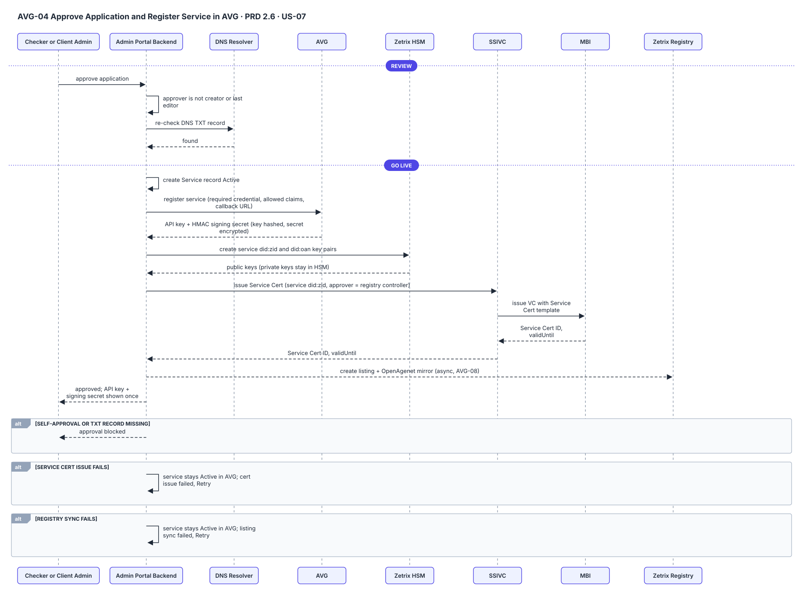
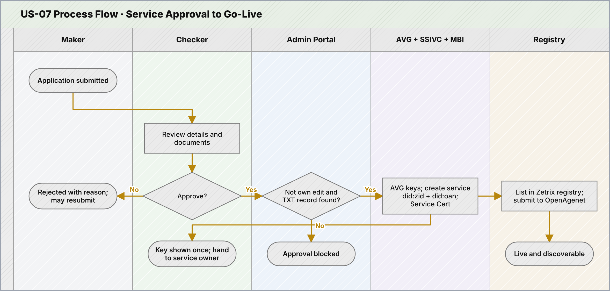

# Approve or Reject Application

Approval is the trust decision. On approval the service is registered in AVG, gets its first API key and signing secret, receives a Service Cert, and is listed in the Zetrix registry. Maker and Checker must be different people.

## **Business Rules**

| Rule | Detail |
| --- | --- |
| Segregation | A Checker or Client Admin can decide applications of their own company, but never one they created or last edited. A company needs at least two users who can submit or approve. |
| Decision | Approve or Reject. Reject needs a reason (min 10 characters); the Maker sees it. |
| Review documents | PDFs and images open in a new tab; any file can be downloaded. Every view and download is audited. |
| Re-check domain | On Approve, the DNS TXT record is checked again. If missing or changed, approval is blocked. |
| Zetrix oversight | Zetrix can view all applications and suspend any service. Zetrix approval of each service is not required in the pilot. |
| Result notice | The submitter (and last editor) gets an "Approved" or "Needs changes" email. |

## **On Approval**

The system:

1. Creates the Service record as `Active`.
2. Registers the service in AVG's OID4VP verifier with its credential, allowed claims and callback URL.
3. Generates the API key and HMAC signing secret.
4. Creates the service's **did:zid** and **did:oan**; private keys are created and kept in the Zetrix HSM and never given to the service.
5. Asks SSIVC to issue the Service Cert (SSIVC calls MBI).
6. Requests the Zetrix registry listing and the OpenAgenet mirror (asynchronous).

The API key and signing secret are shown **once** to the approver, with copy buttons. Only hashes / encrypted values are stored. Afterwards only the key prefix and last 4 characters are shown.

| Partial failure | Behaviour |
| --- | --- |
| Registry or mirror sync fails | Service stays Active in AVG; listing shows "sync failed" with Retry. |
| Service Cert issue fails | Service stays Active in AVG; cert status shows "issue failed" with Retry. |

## **Approving an Update**

Same approval rules. On approval, AVG registration and the Zetrix listing are updated and a new OpenAgenet package version, signed by Zetrix, is submitted. API keys, signing secret, did:zid and did:oan stay the same. If the service name or endpoint domain changed, a new Service Cert is issued and the old one revoked.

## **Field Validation**

| Field | Description | Min | Max | Mandatory |
| --- | --- | --- | --- | --- |
| Decision | Approve / Reject. | — | — | Yes |
| Rejection Reason | Mandatory when Reject. No emojis. | 10 | 500 | No |
| Service ID / API Key ID / API Key (shown once) | Read-only, system generated. | — | — | Yes |

## **Messages**

| Situation | Message |
| --- | --- |
| Reject without reason | "Enter a rejection reason (at least 10 characters)." |
| Self-approval | "You cannot approve an application you created or edited." |
| Domain removed | "Domain check failed. Ask the service owner to restore the TXT record." |

**Sequence Diagram**

<figure><figcaption>
Approve or reject service application
</figcaption></figure>

<figure><figcaption>
Process flow: approve or reject
</figcaption></figure>
