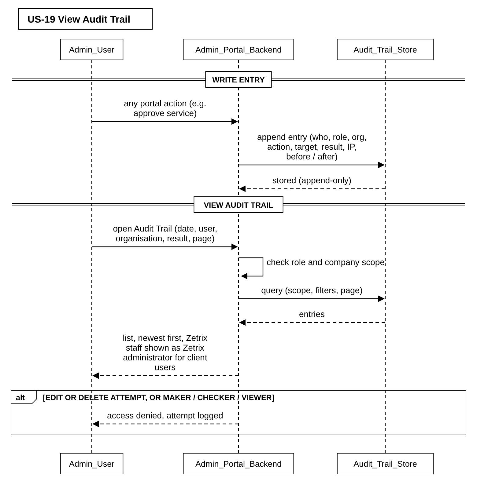

# Audit Trail

The audit trail records who did what in the Admin Portal, when and from where. It covers Admin Portal actions only; agent verification checks are in the verification log.

## **Events Captured**

| # | Area | Events |
| --- | --- | --- |
| 1 | Login and session | Login success / failed, account locked / unlocked, login blocked pending reset, reset link resent, logout, session timed out, forgot password requested, password reset / changed, annual change forced. |
| 2 | Two-factor (2FA) | 2FA set up, own authenticator changed, 2FA reset by an administrator (with reason), fresh code asked (passed or failed). |
| 3 | Users | Invited, invite resent / cancelled / accepted, role changed, deactivated, reactivated, dormant account deactivated by the system. |
| 4 | Client accounts | Created, edited, suspended, reactivated. |
| 5 | Service applications | Created, edited, submitted, document viewed / downloaded, approved, rejected (with reason), update submitted / approved / rejected. |
| 6 | Service status and keys | API key shown, rotated, revoked; signing secret rotated; service suspended, reactivated, delisted (with reason). |
| 7 | Registry and Service Cert | Zetrix listing published / updated, OpenAgenet submission result, sync retried, Service Cert issued, renewed, reissued, revoked. |
| 8 | Logs and access | Access denied (page, record or API call outside the user's role or company). |

Failed attempts are logged too. System-started events are logged with "System" as the user.

## **Entry Details**

Date and time · user name, email, role and organisation · action and target · result (success / failed) · IP address · reason (when asked) · values before and after (for any change).

**Never logged:** passwords, authenticator codes and 2FA secrets, full API keys or signing secrets (only prefix and last 4), uploaded document contents, claim values.

## **Who Can See**

| Role | Scope |
| --- | --- |
| Super Admin, Zetrix Ops | All entries for all companies (view only). |
| Client Admin | Own company: their staff's actions and Zetrix actions on their company. Zetrix staff are shown as "Zetrix administrator". |
| Maker, Checker, Viewer | No access. |

## **Rules**

| Rule | Detail |
| --- | --- |
| Append-only | Nobody, including Super Admin, can edit or delete an entry. API attempts are denied and logged. |
| List view | Date and time, user, role, organisation (Zetrix only), action, target, result. Newest first. Click for full detail. |
| Filters | Date range (default last 7 days, max 90 days per search), user, organisation (Zetrix only), result. |
| Time zone | Stored in UTC; shown in the browser time zone with offset, e.g. `14:05 (UTC+4)`. |
| Export | None in Phase 1. |

## **Field Validation**

| Field | Description | Min | Max | Mandatory |
| --- | --- | --- | --- | --- |
| Date From | Not in the future. Default 7 days ago. | — | — | Yes |
| Date To | Not before Date From or in the future. At most 90 days after Date From. | — | — | Yes |
| User Search | Matches name or email. | 0 | 254 | No |
| Organisation | Zetrix users only. | — | — | No |
| Result | All / Success / Failed. | — | — | No |

## **Messages**

| Situation | Message |
| --- | --- |
| Range too long | "Pick a date range of 90 days or less." |
| No access | "You do not have access to this page." |

**Sequence Diagram**

<figure><figcaption>
View audit trail
</figcaption></figure>
