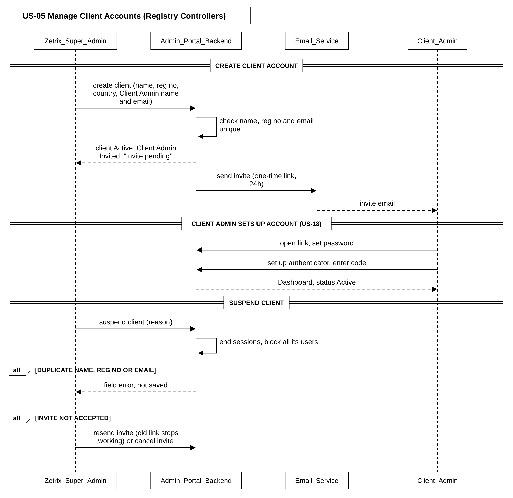

# Client Accounts

Registry controllers (clients) onboard services into the Zetrix registry and take responsibility for them. Zetrix creates each client account and its first Client Admin; the Client Admin then invites their own staff.

## **Business Rules**

| Rule | Detail |
| --- | --- |
| Who | Zetrix Super Admin and Zetrix Ops can create, edit and suspend client accounts. Every change is in the audit trail. |
| Unique | Company name and registration number must be unique. |
| Client Admin invite | Creating a client emails its Client Admin an invite (link valid 24 hours). The Client Admin shows in User Management with status `Invited`. |
| Invite pending | Until the client has at least one Active Client Admin, the list shows "Client Admin invite pending". |
| Pilot scope | Pilot clients are telcos (Omantel, Airtel Africa). |
| Suspend client | All its users are logged out and blocked. Its services stay as they are; Zetrix decides separately whether to suspend them. |

## **Field Validation**

| Field | Description | Min | Max | Mandatory |
| --- | --- | --- | --- | --- |
| Client Name | Company name. Must be unique. | 2 | 100 | Yes |
| Registration Number | As issued in the company's own country (any country). a–z, A–Z, 0–9, space and `-` `.` `/` only. No country-specific format check. | 2 | 50 | Yes |
| Country | ISO country list. | — | — | Yes |
| Client Admin Name | Full name. | 2 | 255 | Yes |
| Client Admin Email | Email address. | 6 | 254 | Yes |
| Client Status | Read-only, system generated. | — | — | Yes |

## **Messages**

| Situation | Message |
| --- | --- |
| Duplicate registration number | "A client with this registration number already exists." |

**Sequence Diagram**

<figure><figcaption>
Manage client accounts (registry controllers)
</figcaption></figure>
