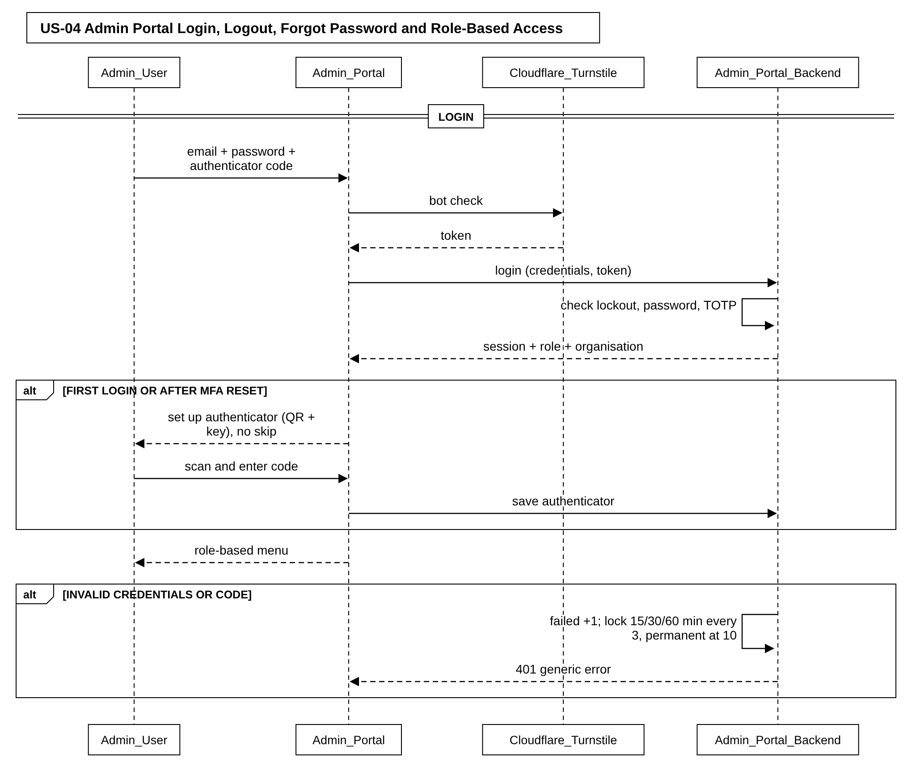
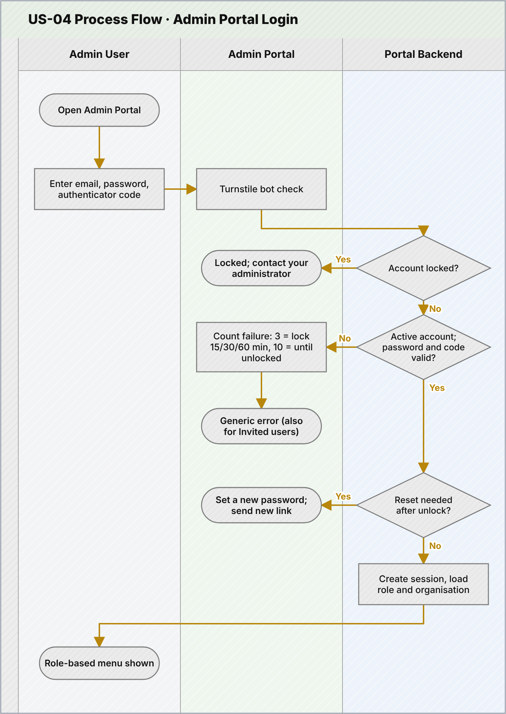

# Login and Account Security

The Admin Portal is classified **High Risk** under the MyEG Password & Authentication Control Matrix v0.9. Access is strong and limited by role, because a wrong approval puts an untrusted service in front of agents.

## **Login**

Login needs **email + password + 6-digit authenticator code (TOTP)**. MFA cannot be turned off. Email OTP and SMS OTP are not allowed as a second factor. Cloudflare Turnstile protects login and forgot password, and requests are rate limited by IP.

**Field Validation**

| Field | Description | Min | Max | Mandatory |
| --- | --- | --- | --- | --- |
| Email Address | Not case sensitive, stored lowercase, trimmed. Part before @ max 64. | 6 | 254 | Yes |
| Password | ASCII printable only, no unicode. Spaces only between characters. Must have uppercase, lowercase, number and special character. Paste and password managers allowed. Show / hide toggle. | 8 | 128 | Yes |
| Authenticator Code | Digits 0–9 only, exactly 6 digits. | 6 | 6 | Yes |

## **Password Rules**

| Rule | Detail |
| --- | --- |
| Composition | 8 to 128 ASCII printable characters with uppercase, lowercase, number and special character. |
| Reuse | Cannot reuse the last 4 passwords or any password used in the last 12 months. |
| Annual change | Users other than Super Admin must change their password at least once a year; prompted at login. |
| Storage | Salted and hashed with Argon2id, scrypt or bcrypt. |

## **Two-Factor Authentication (TOTP)**

| Rule | Detail |
| --- | --- |
| Setup | Right after setting a password from the invite link: scan the QR code (or enter the text key) and enter the 6-digit code. No access until setup is done. |
| Controls | RFC 6238; unique secret encrypted at rest; 30-second step; ±1 step tolerance; each code usable once; codes and secrets never logged. |
| Fresh code | Asked again right before: changing own password, changing own authenticator, resetting another user's 2FA, and role changes. Not for approvals, API keys or service status. |
| Change authenticator | From My Account: confirm current password and code, scan the new QR, enter the new code. The old one stops working only after the new one is confirmed. |
| Lost authenticator | Cannot self-reset. An administrator resets it with a reason; the user sets up a new authenticator at next login. No backup codes in Phase 1. |
| Passkey | Later phase. |

## **Lockout**

| Failures | Effect |
| --- | --- |
| 3 | Locked 15 minutes |
| next 3 | Locked 30 minutes |
| next 3 | Locked 60 minutes |
| 10 in total | Locked until an administrator unlocks it. Unlock forces a password reset (one-time link, 2 hours). |

Each lock is emailed to the user and written to the audit trail. The failure count resets after a successful login.

## **Forgot Password**

The same message is shown whether the email exists or not: *"If an account exists, a reset link has been sent."* The one-time reset link is valid for 2 hours. After a reset, all the user's sessions end.

## **Sessions**

| Rule | Detail |
| --- | --- |
| Idle timeout | 15 minutes; full login needed. No remember-me or silent refresh. |
| Absolute timeout | 8 hours. |
| Concurrency | One active session per user. |
| Forced end | Password change, password reset, MFA reset and deactivation end all sessions. |
| Dormancy | Accounts (other than Super Admin) not used for 1 year are deactivated automatically. |

## **User Messages**

| Situation | Message |
| --- | --- |
| Wrong email, password or code | "Invalid email, password or code." |
| Expired reset link | "This link has expired. Request a new one." |
| Weak password | "Use uppercase, lowercase, a number and a special character." |
| Unicode or edge spaces | "Use standard keyboard characters. Spaces only between characters." |
| Reused password | "You used this password before. Choose a new one." |
| Wrong code at setup | "Invalid code. Check the app and try again." |
| Old password after unlock | "You need to set a new password. We sent a reset link to your email." |
| No sign-up | "Ask your admin for access" |

**Sequence Diagram**

<figure><figcaption>
Admin Portal login, logout, forgot password and role-based access
</figcaption></figure>

<figure><figcaption>
Process flow: login
</figcaption></figure>
