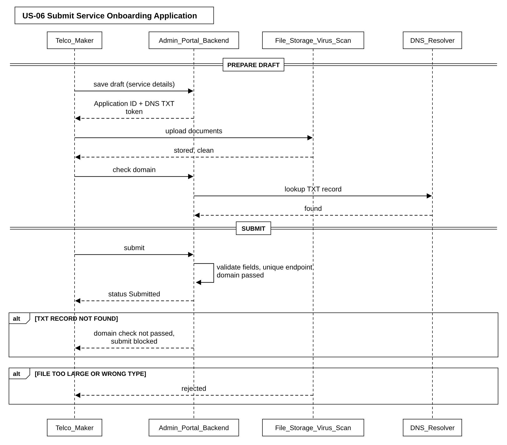
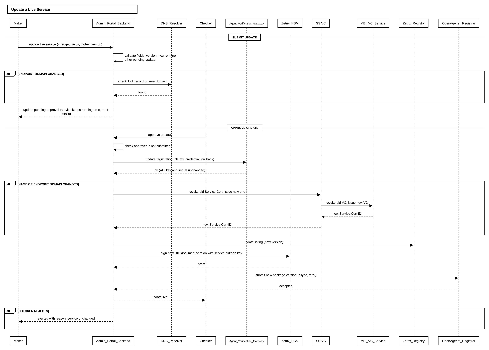

# Service Onboarding Application

The intake step for any website, agent, API or MCP server that wants to check agent identity through AVG. The application captures who runs the service, where it lives, and what identity proof it will ask agents for. A **Maker** or **Client Admin** submits it.

## **Statuses**

`Draft` → `Submitted` → `Approved` / `Rejected`

* A Submitted application is read-only for the Maker until it is decided.
* A Rejected application can be edited and resubmitted. Editing moves it back to `Draft` with the same Application ID; the rejection reason stays visible.
* An Approved application becomes a Service record.

## **Domain Control (DNS TXT)**

The service owner must prove control of the endpoint domain.

| Step | Detail |
| --- | --- |
| 1 | The portal shows a TXT record unique to the application: name `_zetrix-verify.<endpoint domain>`, value `zetrix-verify=<token>`. |
| 2 | The service owner adds it at their DNS provider. |
| 3 | The Maker clicks **Check Domain**. `Passed`: record exists and value matches. `Not found`: missing or wrong; check again later (DNS changes can take up to 48 hours). |
| 4 | Submit is allowed only when the check has Passed. The token stays the same for the life of the application. |

If the endpoint URL moves to a different domain, the status resets to `Not checked` and a new token is shown. The record is re-checked on approval; keep it while the service is active.

## **Credential and Claims**

**Required credential**

| Option | Accepts |
| --- | --- |
| Basic Agent Cert only | Basic Agent Cert |
| Verified Agent Cert only | Verified Agent Cert (owner checked through MyDigital ID) |
| Basic or Verified Agent Cert | Either |

**Claims**

| Required credential | Default claims (always included, fixed) | Extra claims (optional) |
| --- | --- | --- |
| Basic only | agent name | agent purpose |
| Verified only, or Basic or Verified | agent name, owner-verified flag, evidence provider | assurance level, evidence date, agent purpose, owner name, owner ID number, date of birth, country of origin, owner phone number |

Owner name, owner ID number, date of birth, country of origin and owner phone number are **personal claims** and need a written justification. ID type is not picked separately; it is shared together with owner ID number. AVG refuses proof requests for claims outside the service's list.

## **Result Delivery**

Every service gets AVG's signed result both ways (x401 header via the agent, and callback). This is fixed. The **Callback URL** is mandatory, must use HTTPS and must be on the domain that passed the domain check.

## **Field Validation**

| Field | Description | Min | Max | Mandatory |
| --- | --- | --- | --- | --- |
| Application ID | Read-only, system generated. | — | — | Yes |
| Service Name | a–z, A–Z, 0–9 and `- _ . ( ) & ' /`. Spaces between characters only. | 2 | 100 | Yes |
| Service Type | Agent Service / Skill / MCP Server / Tool or API. | — | — | Yes |
| Service Endpoint URL | Must start with `https://`. Valid URL, no spaces. | 12 | 2048 | Yes |
| Service Description | Free text, no emojis. | 10 | 500 | Yes |
| Service Owner Company Name | Company name. | 2 | 100 | Yes |
| Business Registration Number | Any country. a–z, A–Z, 0–9, space and `-` `.` `/` only. | 2 | 50 | Yes |
| Country | ISO country list. | — | — | Yes |
| Technical Contact Name | Full name. | 2 | 255 | Yes |
| Technical Contact Email | Email address. | 6 | 254 | Yes |
| Technical Contact Phone | Country code + digits, stored as E.164. 8 to 15 digits total. | 8 | 15 | Yes |
| Required Credential | See above. | — | — | Yes |
| Allowed Claims (extra) | Multi-select. For Basic only, agent purpose is the only extra claim shown. | 0 | 8 | No |
| Justification for Personal Claims | Mandatory if any personal claim is selected. No emojis. | 20 | 500 | No |
| Callback URL | `https://`, host on the verified endpoint domain. | 12 | 2048 | Yes |
| OpenAgenet Domains | One or more listing domains (list TBC with CAICT, OD-31). | 1 | 10 | Yes |
| Manifest / Schema / Artifact Link | `https://` link to the manifest, API schema or package. | 12 | 2048 | Yes |
| Service Version | e.g. `1.0.0`. Letters, numbers and `.` `-`. Higher than current on an update. | 1 | 20 | Yes |
| Output Description | What the service returns. | 10 | 500 | Yes |
| Input Description | What the service needs from the agent. | 10 | 500 | Yes |
| Use Case Examples | One example per line. | 10 | 1000 | Yes |
| Capability Tags | Letters, numbers and `-`. Max 30 characters per tag. | 1 tag | 10 tags | Yes |
| Supporting Documents | PDF / JPG / PNG, max 5 MB each. | 1 file | 15 files | Yes |
| DNS TXT Token / Domain Check Status | Read-only, system generated. | — | — | Yes |

## **Other Rules**

| Rule | Detail |
| --- | --- |
| Unique endpoint | The same endpoint URL cannot exist in another application (Draft, Submitted or Rejected) or service (Active or Suspended). Only a Delisted service releases it. |
| Documents | At least one supporting document (e.g. company registration certificate). |
| Review notice | On submit, all Active Checkers and Client Admins of the company, except the submitter, get a "Waiting for your review" email. |

## **Update a Live Service**

A Maker or Client Admin of the same company can submit an update to an Active service. Any field can change except service type.

* The service version must be higher than the current one.
* If the endpoint domain changes, the domain check must pass again.
* Only one pending update per service at a time.
* The service keeps running on its current details until the update is approved. A rejected update leaves the service unchanged.

## **Messages**

| Situation | Message |
| --- | --- |
| Domain not verified | "Domain check not passed. Add the TXT record and check again." |
| Non-HTTPS endpoint | "Endpoint must use https://" |
| Personal claim without justification | "Explain why this service needs personal claims." |
| Duplicate endpoint | "This endpoint is already registered." |
| Endpoint held by rejected application | "This endpoint is held by rejected application [ID]. Edit that application and submit again instead." |
| Invalid file | "Only PDF, JPG or PNG up to 5 MB." |
| Too many files | "Maximum 15 files." |
| Callback missing | "Callback URL is required." |
| Callback off-domain | "Callback URL must be on the verified domain." |
| Version not increased | "Version must be higher than the current version ([version])." |

**Sequence Diagrams**

<figure><figcaption>
Submit service onboarding application
</figcaption></figure>

<figure><figcaption>
Update a live service
</figcaption></figure>
