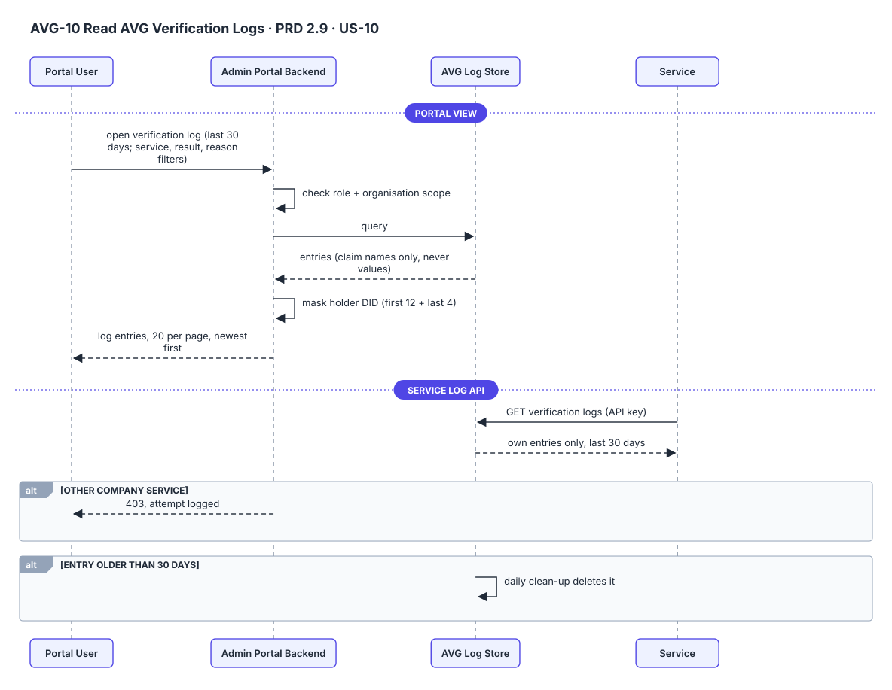

# Services and Verification Logs

The verification log is the record of every check AVG did for a service. Registry controllers and Zetrix use it to fix failing integrations, spot abuse or unusual volume, and answer audit questions.

## **Service List**

| Item    | Detail                                                                                                 |
| ------- | ------------------------------------------------------------------------------------------------------ |
| Columns | Service name, type, status, listing status, required credential, created date, last verification time. |
| Filters | Status (All / Active / Suspended / Delisted), type, date range.                                        |
| Search  | By name or endpoint (0 to 100 characters).                                                             |
| Scope   | Client users see their own company's services; Zetrix sees all.                                        |

## **Verification Log**

**Entry content**

| Field                    | Detail                                                                                                          |
| ------------------------ | --------------------------------------------------------------------------------------------------------------- |
| Timestamp                | Time of the check.                                                                                              |
| Proof request ID         | —                                                                                                               |
| Service reference        | The service's own reference, if sent.                                                                           |
| Result                   | Verified / Failed.                                                                                              |
| Reason                   | Reason code with its description. See [Result and Error Codes](../api-specification/result-and-error-codes.md). |
| Credential type          | Basic / Verified.                                                                                               |
| Claim names disclosed    | Names only, never values.                                                                                       |
| Holder identifier        | Masked: first 12 + last 4 characters.                                                                           |
| Callback delivery status | e.g. Delivered, Callback failed.                                                                                |

**Filters**

| Filter     | Options                                        |
| ---------- | ---------------------------------------------- |
| Date range | Last 30 days only. From cannot be after To.    |
| Service    | All services, or one (all-services page only). |
| Result     | All / Verified / Failed.                       |
| Reason     | All, or one reason code.                       |

## **Failed Checks Tile**

The Dashboard shows a **Failed checks today** tile for the services the user can see: failure percentage, count (e.g. `5%`, `1 of 20`) and the most common reason. "Today" is the current UTC day. With no checks it shows "No checks yet today". Clicking it opens Verification Logs filtered to Result = Failed and today's date.

## **Privacy and Retention**

* Claim values are never stored or shown in the portal or log API. They go only to the service inside AVG's signed result.
* Logs are kept 30 days, then deleted by a daily clean-up job.
* No CSV export in Phase 1. Services read their own logs through the AVG log API (`GET /v1/logs`, see **Logs** under [API Specification](../api-specification/README.md)).

## **Messages**

| Situation          | Message                             |
| ------------------ | ----------------------------------- |
| Invalid date range | "From date must be before To date." |

**Sequence Diagram**

<figure><figcaption>
View services and verification logs
</figcaption></figure>
