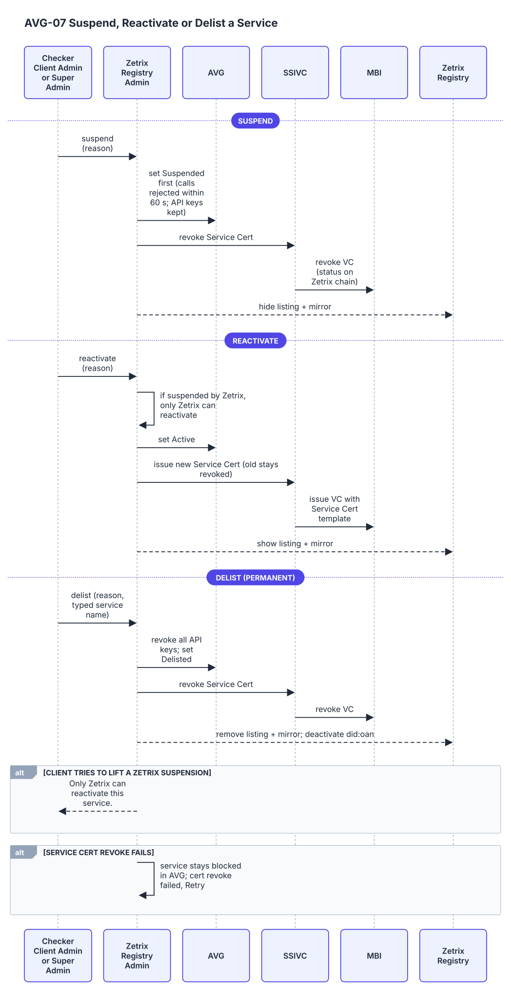
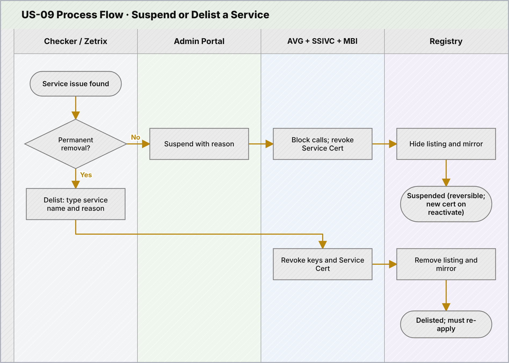

# Suspend, Reactivate or Delist

Services can go bad after approval. Suspension is a fast, reversible stop. Delisting is permanent.

## **Who**

| Action | Allowed roles |
| --- | --- |
| Suspend, reactivate | Checker and Client Admin (own company), Zetrix Super Admin (any service) |
| Delist | Checker, Client Admin, Super Admin |
| — | Zetrix Ops cannot suspend, reactivate or delist. |

## **Actions**

| Action | Transition | Effect |
| --- | --- | --- |
| Suspend | Active → Suspended | AVG rejects the service's calls with `SERVICE_SUSPENDED` within 60 seconds. Service Cert revoked. Registry listing and OpenAgenet mirror hidden. API keys kept. |
| Reactivate | Suspended → Active | A new Service Cert is issued (a revoked VC cannot be restored). Listing shown again. A Zetrix suspension can only be lifted by Zetrix. |
| Delist | Any → Delisted | Permanent. All API keys revoked, Service Cert revoked, listing and mirror removed, did:oan deactivated. The service must apply again. |

## **Rules**

| Rule | Detail |
| --- | --- |
| Reason | Mandatory for every change; kept in the audit trail. |
| Confirmation | Delist needs the service name typed to confirm. |
| Order safety | AVG and the Service Cert are updated first, then the registry and mirror. |
| Suspension notice | When Zetrix suspends a service, the owning company's Active Client Admins get an email with the reason. |
| Revoke failure | If the Service Cert revoke fails, the service still stays blocked in AVG; cert status shows "revoke failed" with Retry. |

## **Field Validation**

| Field | Description | Min | Max | Mandatory |
| --- | --- | --- | --- | --- |
| Action | Only actions valid for the current status are shown. | — | — | Yes |
| Reason | Free text, no emojis. | 10 | 500 | Yes |
| Confirm Service Name | Must match exactly. Delist only. | 2 | 100 | No |

## **Messages**

| Situation | Message |
| --- | --- |
| Client tries to lift Zetrix suspension | "Only Zetrix can reactivate this service." |
| Reason too short | "Enter a reason (at least 10 characters)." |
| Name mismatch | Delist button stays disabled. |

**Sequence Diagram**

<figure><figcaption>
Suspend, reactivate or delist a service
</figcaption></figure>

<figure><figcaption>
Process flow: suspend, reactivate or delist
</figcaption></figure>
