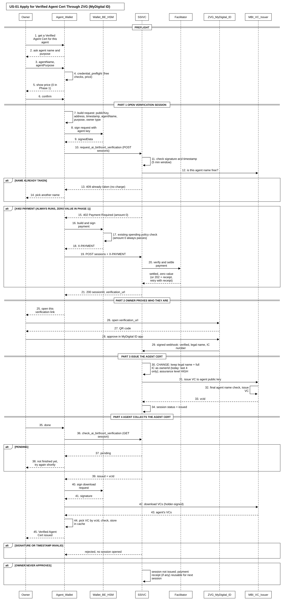

# Apply for Verified Agent Cert

The owner's agent applies for a Verified Agent Cert, and the owner confirms they are the owner with MyDigital ID through ZVG, so the agent can prove to services that it belongs to a real, verified person.


In Phase 1, MyDigital ID is the only owner identity check, and Agent Cert issuance is free.


## **Flow**

| Step | Actor | Action |
| --- | --- | --- |
| 1 | Owner | Asks the agent for a Verified Agent Cert. |
| 2 | Agent | Asks the owner for the agent name and purpose, runs the price check and shows the price (0 in Phase 1). Owner confirms. |
| 3 | Agent | Sends a session request to SSIVC, signed with the agent key through Wallet BE + HSM. |
| 4 | SSIVC | Checks the signature and timestamp, asks MBI whether the agent name is free, and returns a session ID and ZVG verification link. |
| 5 | Owner | Opens the link, scans the QR code shown by ZVG and approves in the MyDigital ID app. |
| 6 | ZVG | Sends SSIVC a signed webhook with the result, legal name and IC number. |
| 7 | SSIVC | Asks MBI to issue the Verified Agent Cert to the agent's public key. |
| 8 | Agent | Checks the session status. When issued, downloads its VCs from MBI with a holder-signed request, picks the one with the returned credential ID, checks it and stores it. |

## **Business Rules**

| Rule | Detail |
| --- | --- |
| Who issues | The agent applies to SSIVC, not MBI. SSIVC runs the owner check through ZVG and asks MBI to issue. MBI is the only issuer. |
| Signed request | The session request (public key, address, timestamp, agent name, purpose, owner type) is signed with the agent key. SSIVC rejects it if the signature is invalid or the timestamp is older than 5 minutes. |
| Owner check | The wallet never talks to MyDigital ID; only SSIVC and ZVG do. |
| Fee | Price is 0, but the x402 steps still run as a zero-value payment: `402 Payment Required` (amount 0), `X-PAYMENT`, verify and settle through the Facilitator. No money is charged. |
| Agent name | SSIVC asks MBI whether the name is free before opening the session; a taken name is rejected with no charge. MBI checks again at issue. |
| Personal data | The cert holds the owner's legal name, full ID number with its ID type, date of birth, country of origin and phone number. ID number, date of birth, country of origin and phone number are not disclosed by default. |
| Evidence fields | `evidenceProvider` = `mydigitalid`; `evidenceMethod` set; `evidenceDate` set; `ownerVerified` = `true`. Expiry follows the validity MyDigital ID returns. |
| Assurance level | Set by Zetrix per identity source, not by the service or owner. Phase 1: MyDigital ID = `HIGH`. |
| Session | If the owner never approves, no Agent Cert is issued. A payment receipt, if any, can be reused for the next session. |
| Non-Malaysian owners | Owners without MyDigital ID can only get a Basic Agent Cert in Phase 1. |
| One Verified Agent Cert | The wallet holds one Verified Agent Cert. Applying again replaces it (price re-checked with `replacing = true`, owner re-verifies, new name must be free). The old cert is **not** revoked automatically; it stays valid until it expires or Zetrix revokes it. |

## **Outcomes**

| Situation | Result |
| --- | --- |
| Owner approves | MBI issues the Verified Agent Cert; `ownerId` holds the full IC number, `evidenceProvider` = `mydigitalid`, `evidenceAssuranceLevel` = `HIGH`. |
| Name already taken | Rejected before the session starts, no charge. Owner picks another name. |
| Invalid signature or stale timestamp | Rejected; no session opened. |
| Owner has not finished | Agent tells the owner it is not finished yet. |
| Owner never approves | Session expires; no cert issued; receipt reusable. |

**Sequence Diagram**

<figure><figcaption>
Apply for Verified Agent Cert through ZVG (MyDigital ID)
</figcaption></figure>
