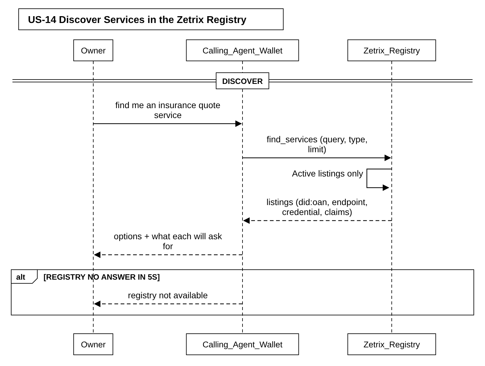

# Discover Services

## **find\_services**

Searches the Zetrix registry for approved services by keyword and optional service type.

**Description**

Agents need a trusted place to find services. Only services approved through the Admin Portal and currently Active appear. Each result tells the agent which credential and claims the service will ask for, so the agent can warn the owner early. In Phase 1 agents search the Zetrix registry (the source of truth); searching OpenAgenet directly is not in Phase 1.

**Wallet Tool**

| Tool | Provided by |
| --- | --- |
| `find_services` | Zetrix Agentic Wallet MCP (new tool) |

**Input:** *(JSON)*

```json
{
    "query": "insurance quote",
    "serviceType": "Tool or API",
    "limit": 10
}
```

| Type | Params | Required | Description |
| --- | --- | --- | --- |
| string | `query` | Yes | Free-text keyword. 2 to 100 characters, trimmed, no emojis. |
| string | `serviceType` | No | `Agent Service`, `Skill`, `MCP Server` or `Tool or API`. |
| integer | `limit` | No | 1 to 50. Default 10. |

**Validation Rules**

| Field | Rule | Error Message |
| --- | --- | --- |
| `query` | 2 to 100 characters | "query too short" |
| `limit` | 1 to 50 | "invalid limit" |

**Output:** *(JSON)*

```json
{
    "services": [
        {
            "serviceName": "QuickQuote Insurance API",
            "did": "did:zid:7a1c...9f02",
            "didOan": "did:oan:<routing>:<suffix>",
            "serviceType": "Tool or API",
            "endpointUrl": "https://api.quickquote.com/v1",
            "description": "Instant motor insurance quotations.",
            "requiredCredential": "VERIFIED",
            "requestedClaims": ["agentName", "ownerVerified", "evidenceProvider", "ownerName"],
            "registryController": "Omantel",
            "serviceCertId": "<service-cert-vc-id>",
            "avgUrl": "https://<avg-host>"
        }
    ]
}
```

| Type | Params | Description |
| --- | --- | --- |
| string | `serviceName` | Service name from the approved application. |
| string | `did` | Service did:zid (key of the Zetrix registry). |
| string | `didOan` | Service did:oan (OpenAgenet identity). |
| string | `serviceType` | Service category. |
| string | `endpointUrl` | Service endpoint (HTTPS). |
| string | `description` | Service description. |
| string | `requiredCredential` | `BASIC`, `VERIFIED` or `BASIC_OR_VERIFIED`. |
| array of string | `requestedClaims` | Claims the service is approved to ask for. |
| string | `registryController` | Organisation that onboarded and vouches for the service. |
| string | `serviceCertId` | ID of the service's Service Cert. |
| string | `avgUrl` | Where agents submit VPs for this service. Phase 1: the Zetrix AVG URL. |

**Error Responses**

| Code | Message | Description |
| --- | --- | --- |
| QUERY\_TOO\_SHORT | `query too short` | Query under 2 characters. |
| REGISTRY\_UNAVAILABLE | `registry unavailable` | Registry did not answer within 5 seconds. The agent tells the owner and does not guess endpoints. |

**Notes**

* No match returns an empty list with no error.
* Suspended and delisted services are never returned.
* Search does not need an Agent Cert in Phase 1.
* Target performance: P95 under 1 second.

**Sequence Diagram**

<figure><figcaption><p>Discover services in the Zetrix registry</p></figcaption></figure>
