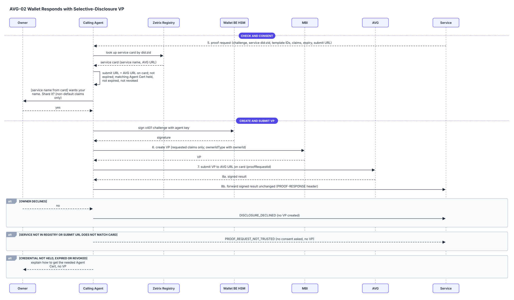

# Respond to Proof Request

## **Identity Proof Function**

Answers a service's proof request with a selective-disclosure VP that shows only the requested claims and signs the x401 challenge.

**Description**

Steps 5 to 8b of the service call flow. The agent receives the proof request from the service, checks it against the Zetrix registry, gets the owner's consent where needed, asks MBI to build the VP signed over the x401 challenge, submits the VP straight to AVG, and forwards AVG's signed result to the service.


Owner consent here is about sharing identity claims. It is not permission for the agent to take actions. Action permission policy is Phase 2.


**Input**

The proof request as returned by `POST /v1/proof-requests` (see **Proof Requests** under [API Specification](../api-specification/README.md)), passed on unchanged by the service:

| Type            | Params               | Description               |
| --------------- | -------------------- | ------------------------- |
| string          | `proofRequestId`     | Proof request ID.         |
| string          | `challenge`          | x401 challenge (nonce).   |
| string          | `expiresAt`          | Expiry time.              |
| object          | `service`            | Service name and did:zid. |
| object          | `acceptedCredential` | Label and template IDs.   |
| array of string | `requestedClaims`    | Claims to disclose.       |
| string          | `verifierId`         | AVG's verifier ID.        |
| string          | `submitUrl`          | Where to submit the VP.   |

**Pre-Checks** (before consent or VP creation)

| Check            | Rule                                                                                                       | Error                                                                   |
| ---------------- | ---------------------------------------------------------------------------------------------------------- | ----------------------------------------------------------------------- |
| Service trusted  | Service did:zid is listed in the Zetrix registry, and `submitUrl` matches the AVG URL on its service card. | `PROOF_REQUEST_NOT_TRUSTED`: no consent asked, no VP created.           |
| Not expired      | `expiresAt` has not passed.                                                                                | `PROOF_REQUEST_EXPIRED`                                                 |
| Credential held  | Agent holds a credential with one of the accepted template IDs.                                            | `CREDENTIAL_NOT_HELD`: agent explains how to get a Verified Agent Cert. |
| Credential valid | That credential is not expired and not revoked.                                                            | `CREDENTIAL_EXPIRED` / `CREDENTIAL_REVOKED`                             |

**Consent Rules**

| Claim group        | Claims                                                                                                                         | Owner consent                                                                        |
| ------------------ | ------------------------------------------------------------------------------------------------------------------------------ | ------------------------------------------------------------------------------------ |
| Default (Basic)    | `agentName`                                                                                                                    | Not asked                                                                            |
| Default (Verified) | `agentName`, `evidenceProvider`, `ownerVerified`                                                                               | Not asked                                                                            |
| Other claims       | `ownerName`, `ownerId`, `ownerPhoneNumber`, `dob`, `countryOfOrigin`, `agentPurpose`, `evidenceAssuranceLevel`, `evidenceDate` | Owner must agree in chat for this service, every time (no saved consent in Phase 1). |

The consent question names the service using the name on its **Zetrix registry service card**, never the name inside the proof request, for example: _"QuickQuote Insurance API wants to see your name. Share it?"_

**VP Creation**

| Rule            | Detail                                                       |
| --------------- | ------------------------------------------------------------ |
| Revealed claims | Requested claims only.                                       |
| Challenge       | Signed with the agent key in the HSM.                        |
| ID type         | If `ownerId` is revealed, `ownerIdType` is revealed with it. |
| Builder         | MBI VP create API (existing).                                |

**Submission and Forwarding**

| Step | Rule                                                                                     |
| ---- | ---------------------------------------------------------------------------------------- |
| 7    | Submit the VP to AVG at the `submitUrl` for that `proofRequestId`, never to the service. |
| 8b   | Forward AVG's signed result to the service unchanged. Any change breaks the signature.   |

**Outcomes**

| Situation                    | Behaviour                                                                                                   |
| ---------------------------- | ----------------------------------------------------------------------------------------------------------- |
| Default claims only          | VP built and submitted without asking the owner.                                                            |
| Owner agrees                 | VP built with the consented claims and submitted.                                                           |
| Owner declines               | No VP created; agent tells the service `DISCLOSURE_DECLINED`.                                               |
| AVG returns `MISSING_CLAIMS` | Agent needs a new proof request from the service; the consent check runs again. An old VP is never changed. |

**Sequence Diagram**

<figure><figcaption>
Respond to proof request with selective-disclosure VP
</figcaption></figure>
