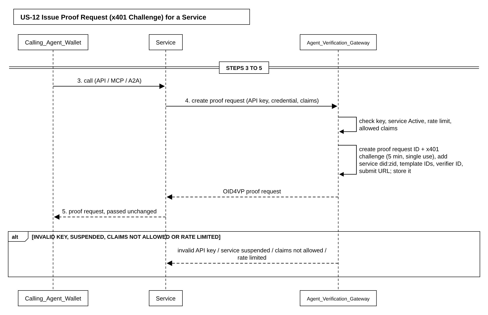

# Proof Request

## **Create Proof Request**

Creates a single-use OID4VP proof request with an x401 challenge for an agent that is calling the service.

**Description**

This is step 4 of the service call flow. When an agent calls your service, your service asks AVG for a proof request using its API key. AVG creates an OID4VP presentation request carrying a one-time x401 challenge (nonce) that the agent must sign, and stores it so it can check the agent's VP in step 7. Your service passes the proof request to the agent unchanged (step 5).

AVG does not sign the proof request in Phase 1. Instead, the agent wallet looks up your service card in the Zetrix registry by your service did:zid and only submits VPs to the AVG URL on that card. AVG also checks the VP against the proof request it stored, so a changed request can never pass.

**Request**

| Method | URL |
| --- | --- |
| POST | `/v1/proof-requests` |

**Request Headers**

| Header | Type | Description |
| --- | --- | --- |
| `X-API-Key` | String | Service API key. |
| `Content-Type` | String | Always `application/json` |

**Request Body:** *(JSON)*

```json
{
    "requiredCredential": "VERIFIED",
    "requestedClaims": ["agentName", "ownerVerified", "evidenceProvider"],
    "serviceReference": "quote-req-000123"
}
```

| Type | Params | Required | Description |
| --- | --- | --- | --- |
| string | `requiredCredential` | Yes | `BASIC`, `VERIFIED` or `BASIC_OR_VERIFIED`. Must be the same as, or narrower than, what the service was onboarded with. |
| array of string | `requestedClaims` | No | Claim keys to disclose. Must be within the service's Allowed Claims. If omitted, the default claims are used. |
| string | `serviceReference` | No | Your own tracking reference. Max 64 characters. Echoed back. |

**Validation Rules**

| Field | Rule | Error Message |
| --- | --- | --- |
| `requiredCredential` | Onboarded `Basic only` allows `BASIC`. Onboarded `Verified only` allows `VERIFIED`. Onboarded `Basic or Verified` allows any of the three. | "Credential requirement too low" (`CREDENTIAL_REQUIREMENT_TOO_LOW`) |
| `requestedClaims` | Every claim must be in the service's Allowed Claims. | "Claims not allowed" with the list of extra claims (`CLAIMS_NOT_ALLOWED`) |
| `requestedClaims` | If the request accepts a Basic Agent Cert (`BASIC` or `BASIC_OR_VERIFIED`), only `agentName` and `agentPurpose` can be requested. | "Claims not allowed" (`CLAIMS_NOT_ALLOWED`) |
| `serviceReference` | Max 64 characters. | "Invalid service reference" |

**Default Claims** (used when `requestedClaims` is omitted)

| Accepted credential | Default claims |
| --- | --- |
| `BASIC` or `BASIC_OR_VERIFIED` | `agentName` |
| `VERIFIED` | `agentName`, `ownerVerified`, `evidenceProvider` |

**Response:** *(JSON)*

```json
{
    "status": 200,
    "message": "Success",
    "data": {
        "proofRequestId": "pr_01JD8Q6W1X4M2V9K7T3N5B8C0A",
        "challenge": "u4Xk2pQ9vL7mN3sR8tY1wZ6aB0cD5eF2",
        "expiresAt": "2026-11-20T09:05:00Z",
        "service": {
            "name": "QuickQuote Insurance API",
            "did": "did:zid:7a1c...9f02"
        },
        "acceptedCredential": {
            "label": "VERIFIED",
            "issuer": "did:zid:<zetrix-issuer>",
            "templateIds": ["<verified-agent-cert-template-id>"]
        },
        "requestedClaims": ["agentName", "ownerVerified", "evidenceProvider"],
        "verifierId": "did:zid:<avg-verifier>",
        "submitUrl": "https://<avg-host>/v1/presentations",
        "serviceReference": "quote-req-000123"
    },
    "timestamp": "2026-11-20T09:00:00Z"
}
```

| Type | Params | Description |
| --- | --- | --- |
| string | `proofRequestId` | Unique proof request ID. Each one works for one verification only. |
| string | `challenge` | x401 challenge (nonce), at least 128-bit random. The agent must sign it. |
| string | `expiresAt` | Expiry time: 5 minutes after creation. |
| object | `service` | Service name and service did:zid, so the owner knows who is asking. |
| object | `acceptedCredential` | Label (`BASIC` / `VERIFIED` / `BASIC_OR_VERIFIED`), the Zetrix issuer, and the exact template ID(s) from AVG configuration. A `BASIC_OR_VERIFIED` request lists both template IDs. |
| array of string | `requestedClaims` | Claims the agent must disclose. |
| string | `verifierId` | AVG's verifier ID. |
| string | `submitUrl` | URL where the agent submits its VP. Must match the AVG URL on the service card. |
| string | `serviceReference` | Your reference, echoed back. |

**Error Responses**

| Status | Code | Message | Description |
| --- | --- | --- | --- |
| 401 | INVALID\_API\_KEY | `Invalid API key` | Key unknown, revoked or expired. |
| 403 | SERVICE\_SUSPENDED | `Service suspended` | Service is Suspended or Delisted. |
| 400 | CLAIMS\_NOT\_ALLOWED | `` Claims not allowed: `{claims}` `` | Requested claims outside the service's Allowed Claims, or non-Basic claims requested when a Basic cert is accepted. |
| 400 | CREDENTIAL\_REQUIREMENT\_TOO\_LOW | `Credential requirement too low` | Requested credential is broader than what the service was onboarded with. |
| 429 | RATE\_LIMITED | `Rate limited` | More than 60 proof requests per minute (default). `Retry-After` header returned. |

**Notes**

* Every proof request is logged (without claim values).
* Two proof requests created at the same time always have different IDs and nonces.
* No template ID outside AVG configuration is ever included. Zetrix is the only issuer in Phase 1; the issuer and template IDs are set on the AVG backend by the Zetrix dev team.
* Rate limits per service are configurable by Zetrix Super Admin.

**Sequence Diagram**

<figure><figcaption><p>Issue proof request (x401 challenge) for a service</p></figcaption></figure>
