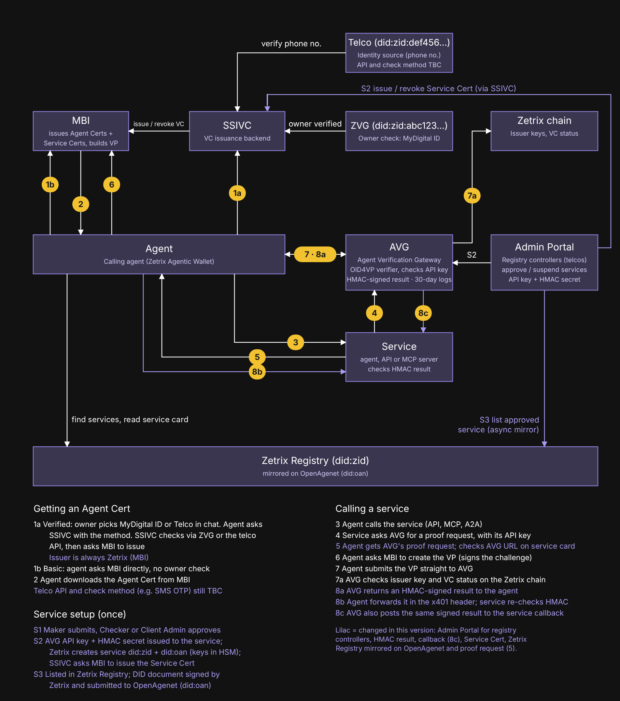

# Architecture

Phase 1 adds three new components (AVG, the Admin Portal and the Zetrix registry) on top of the existing Zetrix identity stack.

<figure><figcaption>
Agentic Zetrix Wallet Phase 1 system architecture
</figcaption></figure>


The diagram shows the Telco identity source. Telco as an owner identity source is **parked** in Phase 1 (OD-01). Phase 1 uses ZVG / MyDigital ID only.


## **Components**

| Component | Status | Role |
| --- | --- | --- |
| Agent (Zetrix Agentic Wallet) | Extended | The owner's calling agent. Holds the Agent Cert, finds services, answers proof requests and forwards AVG's signed result to the service. Agent private keys stay in the Wallet BE HSM. |
| AVG (Agent Verification Gateway) | New | OID4VP verifier. Checks the service API key, issues proof requests, verifies VPs against the Zetrix chain, signs results with HMAC and keeps 30-day logs. |
| Admin Portal | New | Web portal where registry controllers (telcos) onboard and manage services, and Zetrix oversees all services. |
| Zetrix Registry | New | Source of truth for approved, active services (keyed by service did:zid). Mirrored on OpenAgenet (did:oan). |
| MBI VC Service | Existing | Zetrix issuer of all Agent Certs and Service Certs. Builds VPs for the agent. Does not verify VPs. |
| SSIVC | Existing, extended | VC issuance backend. Runs the owner session with ZVG and asks MBI to issue the Verified Agent Cert. New: issues and revokes Service Certs for the Admin Portal. |
| ZVG | Existing | Zetrix Verification Gateway. Checks the human owner through MyDigital ID. |
| Zetrix Chain | Existing | Holds issuer keys and credential status. AVG reads it during verification. |
| Zetrix HSM | Existing | Creates and keeps each service's did:zid and did:oan private keys. They never leave it. |
| OpenAgenet (CAICT) | External | Agent and service discovery network. Receives mirrored listings through its Registrar API. |

## **Numbered Interactions**

**Getting an Agent Cert**

| Step | Interaction |
| --- | --- |
| 1a | Verified: agent asks SSIVC; SSIVC checks the owner through ZVG, then asks MBI to issue. The issuer is always Zetrix (MBI). |
| 1b | Basic: agent asks MBI directly, with no owner check. |
| 2 | Agent downloads the Agent Cert from MBI. |

**Service setup (once)**

| Step | Interaction |
| --- | --- |
| S1 | Maker submits the service; Checker or Client Admin approves it. |
| S2 | AVG API key and HMAC secret are issued to the service. Zetrix creates the service did:zid and did:oan (keys in HSM). SSIVC asks MBI to issue the Service Cert. |
| S3 | Service is listed in the Zetrix registry; its DID document is signed by Zetrix and submitted to OpenAgenet. |

**Calling a service**

| Step | Interaction |
| --- | --- |
| 3 | Agent calls the service (API, MCP or A2A). |
| 4 | Service asks AVG for a proof request, using its API key. |
| 5 | Service passes the proof request to the agent unchanged. The agent checks the AVG URL on the service card. |
| 6 | Agent asks MBI to create the VP and signs the challenge. |
| 7 | Agent submits the VP straight to AVG. |
| 7a | AVG reads the issuer key and VC status on the Zetrix chain. |
| 8a | AVG returns an HMAC-signed result to the agent. |
| 8b | Agent forwards the signed result in the x401 header; the service recomputes the HMAC. |
| 8c | AVG also posts the same signed result to the service's callback URL. |

## **Design Principles**

* **AVG is central in Phase 1.** Zetrix hosts AVG for every service, so Zetrix can see which agent checked with which service. Logs are kept 30 days without claim values. A self-hosted AVG is a later design track (OD-23).
* **MBI is not part of verification.** AVG needs only the Zetrix chain to verify, which also enables a later local AVG.
* **Trust changes first.** Suspend, delist and key revoke reach AVG within 60 seconds and are applied to AVG and the Service Cert before the registry and mirror.
