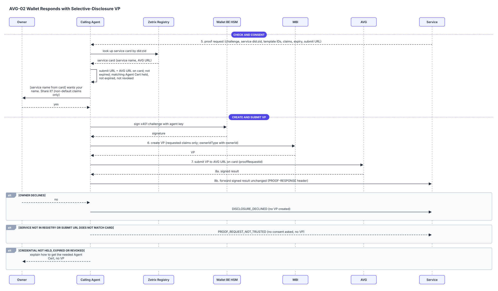
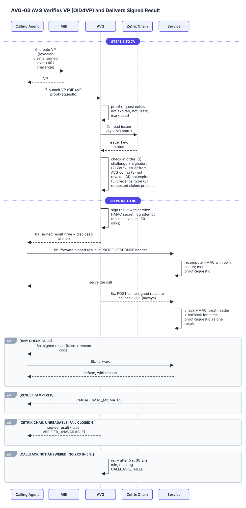
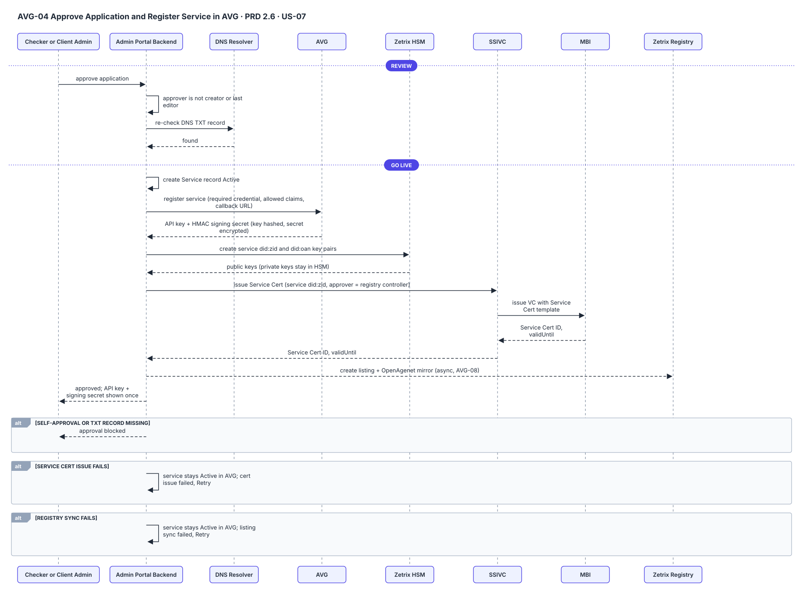
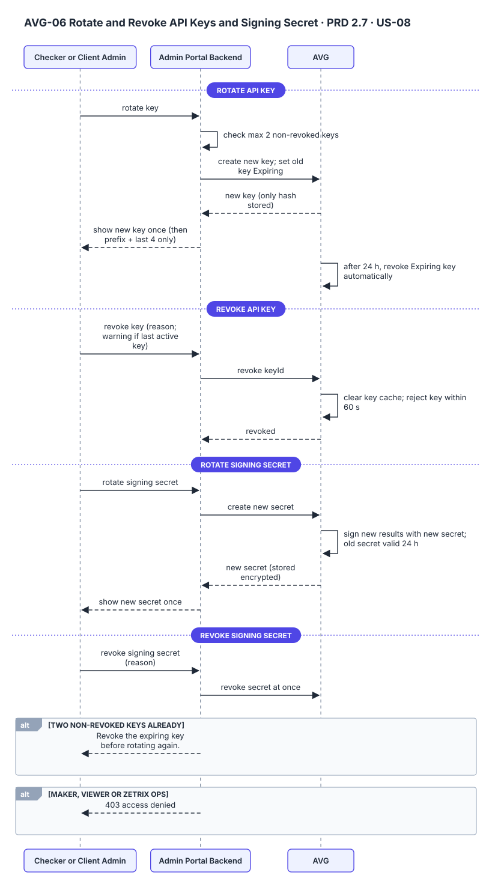
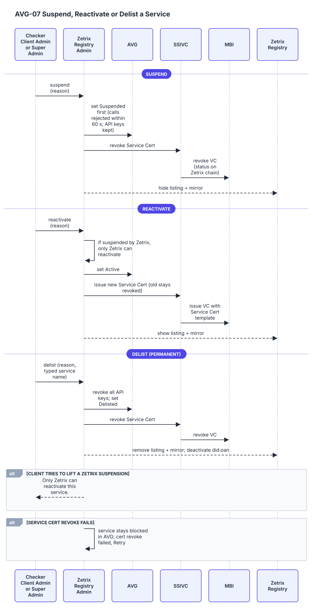
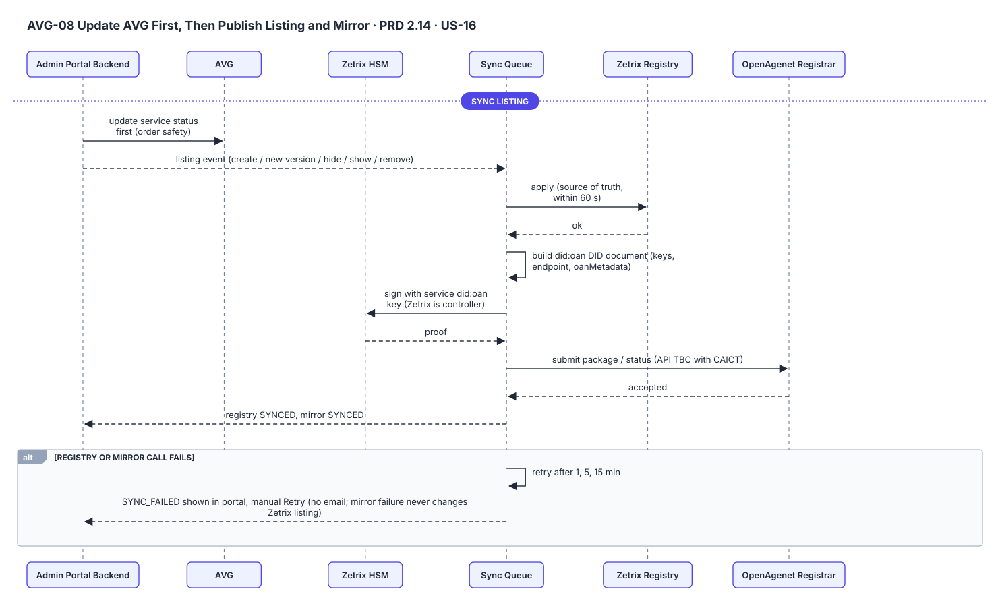
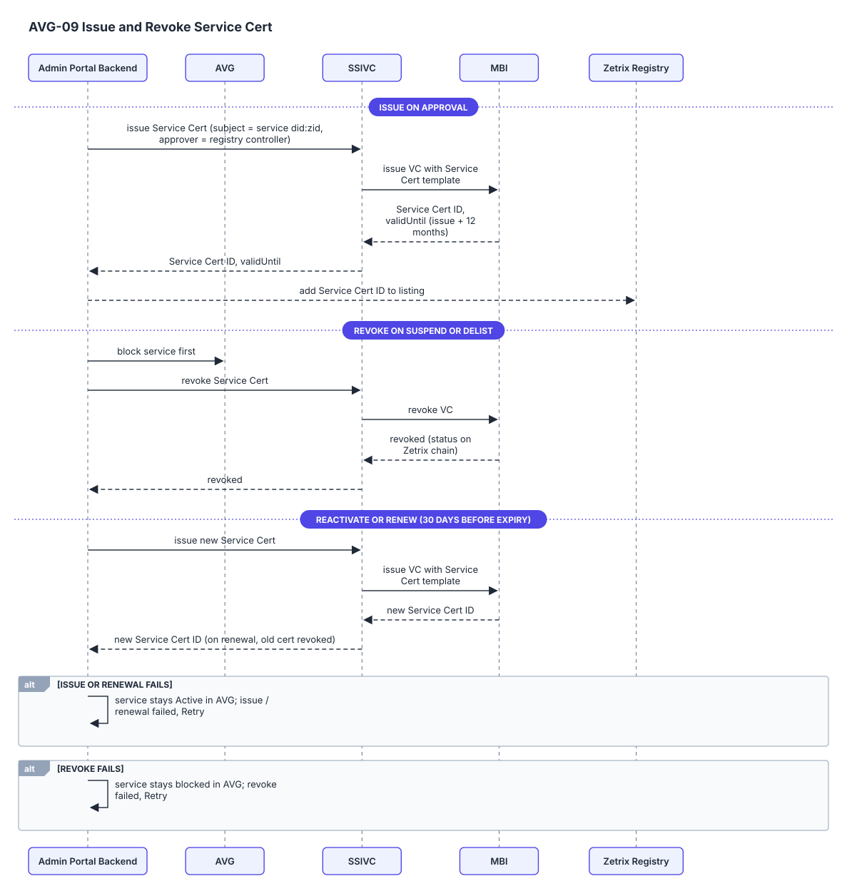

# AVG Flows

Every flow that touches the Agent Verification Gateway, redrawn from PRD\_AZW\_26001 v1.3.1. The flows fall into two groups: the **main AVG flow** that runs on every agent call, and the **Admin Portal to AVG** flows that set up and control a service.


Diagram sources are kept in `diagram-src/*.seq` in the docs repository. Edit a source and run `node diagram-src/seqgen.js diagram-src .gitbook/assets` to regenerate the SVGs.


## **Flow Index**

| Diagram | Group | What it shows | PRD | Original diagram |
| --- | --- | --- | --- | --- |
| [AVG-01](#avg-01-create-proof-request) | Main | AVG creates the proof request (x401 challenge). | 2.10 | seq\_US-12 |
| [AVG-02](#avg-02-wallet-responds-with-selective-disclosure-vp) | Main | The wallet checks the request, gets consent and submits the VP to AVG. | 2.13 | seq\_US-15 |
| [AVG-03](#avg-03-avg-verifies-vp-and-delivers-the-signed-result) | Main | AVG checks the agent's VP, signs the result and sends it to the service. | 2.11 | seq\_US-13\_v1.3.1 |
| [AVG-04](#avg-04-approve-application-and-register-service-in-avg) | Admin to AVG | Registers a service in AVG and returns the API key and HMAC secret. | 2.6 | seq\_US-07 |
| [AVG-05](#avg-05-update-a-live-service-in-avg) | Admin to AVG | Updates a live service in AVG. | 2.5, 2.6 | seq\_US-06U |
| [AVG-06](#avg-06-rotate-and-revoke-api-keys-and-signing-secret) | Admin to AVG | Rotates and revokes API keys and the signing secret. | 2.7 | seq\_US-08\_v1.3.1 |
| [AVG-07](#avg-07-suspend-reactivate-or-delist-a-service) | Admin to AVG | Suspends, reactivates or delists a service. | 2.8 | seq\_US-09 |
| [AVG-08](#avg-08-update-avg-first-then-publish-listing-and-mirror) | Admin to AVG | Updates the service status in AVG before publishing the listing. | 2.14 | seq\_US-16 |
| [AVG-09](#avg-09-issue-and-revoke-service-cert) | Admin to AVG | If cert revoke fails, the service stays blocked in AVG. | 2.15 | seq\_US-17 |
| [AVG-10](#avg-10-read-avg-verification-logs) | Admin to AVG | Reads the AVG verification logs. | 2.9 | seq\_US-10 |

## **Diagram Review Against PRD v1.3.1**

| Original diagram | Result | Change made in the regenerated diagram |
| --- | --- | --- |
| seq\_US-12 | Matches | Error branches split by HTTP status; Phase 1 "proof request not signed" noted. |
| seq\_US-15 | Matches | ownerIdType shared with ownerId (2.13 BR-06). |
| seq\_US-13\_v1.3.1 | Matches | The six checks listed in PRD order (2.11 BR-03); fail-closed noted. |
| seq\_US-07 | Matches | Actor is Checker **or Client Admin** (2.6 BR-01); registry sync failure branch added (2.6 BR-07). |
| seq\_US-06U | Matches | Actor is Maker / Checker **or Client Admin**; "type unchanged" rule added (2.5 BR-11). |
| seq\_US-08\_v1.3.1 | **Gap** | Original covers API keys only. Added signing-secret rotate (24 h overlap) and revoke (2.7 BR-08), last-key warning and role check. |
| seq\_US-09 | Matches | Actor includes Client Admin; did:oan deactivation on delist (2.14 AC4); revoke-failure branch (2.15 BR-11). |
| seq\_US-16 | Matches (PNG newer than .txt) | Retry applies to both registry and mirror; "no email alert" (REL-03). The .txt still says "+ alert". |
| seq\_US-17 | Matches | Renewal 30 days before expiry added (2.15 BR-08). |
| seq\_US-10 | Matches | Service log API path added (2.9 BR-08, OD-24). |
| seq\_US-11 | **Removed** | Trusted issuer management was removed from the Admin Portal in PRD v1.3.0. The Zetrix issuer and template IDs are set on the AVG backend by the Zetrix dev team. Not redrawn. |

***

## Main AVG Flow

### AVG-01 Create Proof Request

The service asks AVG, with its API key, for a single-use proof request. AVG validates the key, service status, rate limit and requested claims, then returns an OID4VP proof request with a 5-minute x401 challenge. See [Proof Request](../api-specification/proof-request.md).

<figure><figcaption>
AVG-01 Create proof request (x401 challenge)
</figcaption></figure>

### AVG-02 Wallet Responds with Selective-Disclosure VP

The wallet trusts the proof request only if the service is in the Zetrix registry and the submit URL matches the AVG URL on its service card. It asks the owner before sharing any non-default claim, has MBI build the VP, and submits it to AVG. See [Respond to Proof Request](../agent-wallet/respond-to-proof-request.md).

<figure><figcaption>
AVG-02 Wallet responds with selective-disclosure VP
</figcaption></figure>

### AVG-03 AVG Verifies VP and Delivers the Signed Result

AVG verifies the VP against the Zetrix chain (MBI is not called), signs the result with the service's HMAC secret, returns it to the agent and posts the same result to the service's callback. See [Verifiable Presentation Submission](../api-specification/vp-submission.md) and [Signed Verification Result](../api-specification/signed-verification-result.md).

<figure><figcaption>
AVG-03 AVG verifies VP (OID4VP) and delivers a signed result
</figcaption></figure>

***

## Admin Portal to AVG (Setup and Control)

### AVG-04 Approve Application and Register Service in AVG

On approval the Admin Portal registers the service in AVG, which returns the API key and HMAC signing secret (shown once). Zetrix creates the service DIDs in the HSM, SSIVC has MBI issue the Service Cert, and the listing is published. See [Approve or Reject Application](../admin-portal/approve-or-reject-application.md).

<figure><figcaption>
AVG-04 Approve application and register service in AVG
</figcaption></figure>

### AVG-05 Update a Live Service in AVG

An approved update changes the AVG registration while keeping the API key, secret and DIDs. A new Service Cert is issued only if the name or endpoint domain changed. See [Service Onboarding Application](../admin-portal/service-onboarding-application.md#update-a-live-service).

<figure><figcaption>
AVG-05 Update a live service in AVG
</figcaption></figure>

### AVG-06 Rotate and Revoke API Keys and Signing Secret

Key and secret rotation keep the old value working for 24 hours; revocation takes effect in AVG within 60 seconds. See [API Keys and Signing Secret](../admin-portal/api-keys-and-signing-secret.md).

<figure><figcaption>
AVG-06 Rotate and revoke API keys and signing secret
</figcaption></figure>

### AVG-07 Suspend, Reactivate or Delist a Service

AVG is always updated first, so a suspended or delisted service is blocked even if the Service Cert or registry update fails. See [Suspend, Reactivate or Delist](../admin-portal/suspend-reactivate-delist.md).

<figure><figcaption>
AVG-07 Suspend, reactivate or delist a service
</figcaption></figure>

### AVG-08 Update AVG First, Then Publish Listing and Mirror

Every listing change updates the service status in AVG before the Zetrix registry and the OpenAgenet mirror. See [Zetrix Registry and OpenAgenet Mirror](../registry/zetrix-registry-and-openagenet.md).

<figure><figcaption>
AVG-08 Update AVG first, then publish listing and mirror
</figcaption></figure>

### AVG-09 Issue and Revoke Service Cert

Service Certs are issued through SSIVC and MBI. If a revoke fails, the service stays blocked in AVG and the portal shows Retry. See [Service Cert](../registry/service-cert.md).

<figure><figcaption>
AVG-09 Issue and revoke Service Cert
</figcaption></figure>

### AVG-10 Read AVG Verification Logs

Portal users read logs within their organisation scope; services read their own logs through the AVG log API. Claim values are never stored. See [Services and Verification Logs](../admin-portal/services-and-verification-logs.md) and [Verification Logs API](../api-specification/verification-logs.md).

<figure><figcaption>
AVG-10 Read AVG verification logs
</figcaption></figure>
