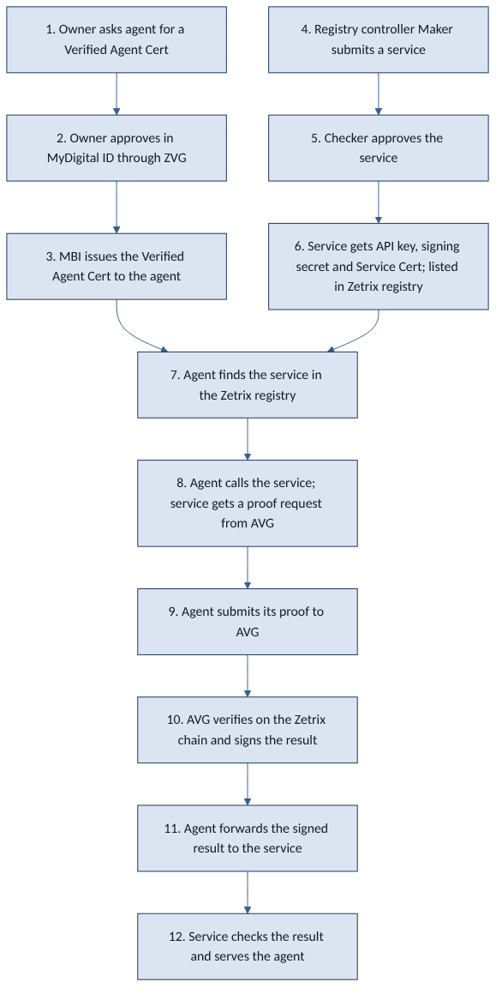
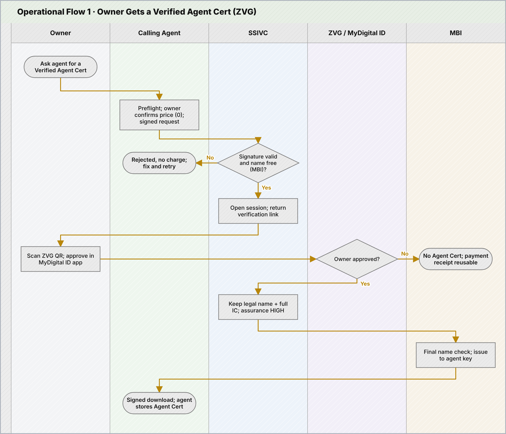
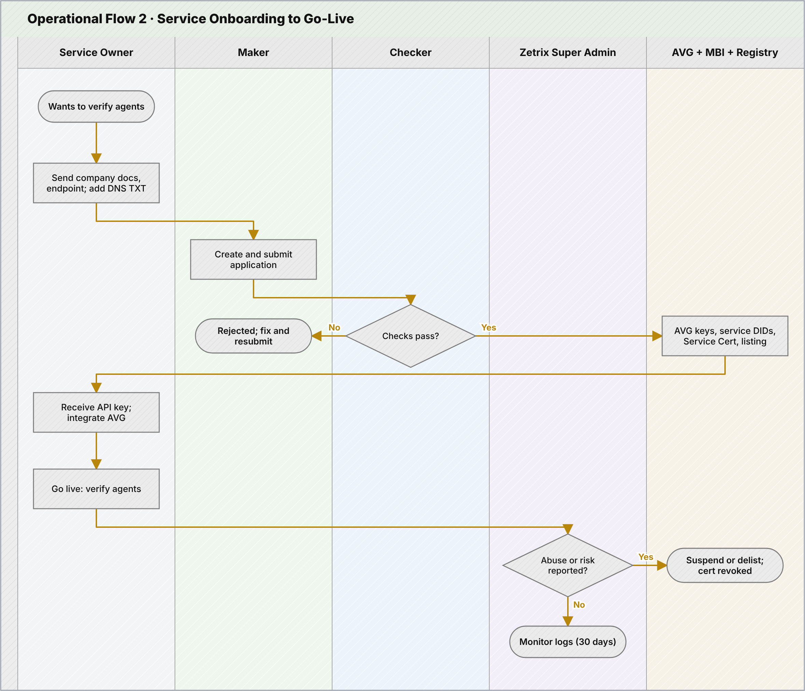
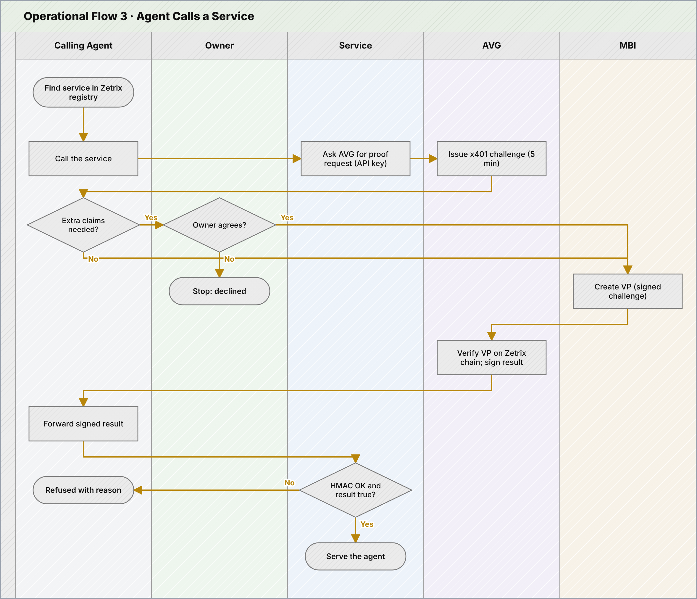

# End-to-End Flow

Phase 1 end to end: an owner gets a Verified Agent Cert, a service is onboarded, and the agent is verified when it calls the service.

<figure><figcaption>
Phase 1 end-to-end flow
</figcaption></figure>

***

## Operational Flow 1: Owner Gets a Verified Agent Cert

The owner asks their agent for a Verified Agent Cert, confirms ownership in the MyDigital ID app through ZVG, and MBI issues the cert to the agent's public key.

<figure><figcaption>
Operational Flow 1: Owner gets a Verified Agent Cert (ZVG)
</figcaption></figure>

See [Apply for Verified Agent Cert](../agent-wallet/apply-verified-agent-cert.md).

***

## Operational Flow 2: Service Onboarding to Go-Live

A registry controller Maker submits the service with domain proof and documents. A different Checker or Client Admin approves it. On approval the service is registered in AVG, receives its API key, signing secret and Service Cert, and is listed in the Zetrix registry and mirrored on OpenAgenet.

<figure><figcaption>
Operational Flow 2: Service onboarding to go-live
</figcaption></figure>

***

## Operational Flow 3: Agent Calls a Service

The agent calls the service. The service gets a proof request from AVG and passes it to the agent. The agent creates a selective-disclosure VP, submits it to AVG and forwards AVG's signed result to the service, which checks the signature and serves the call.

<figure><figcaption>
Operational Flow 3: Agent calls a service
</figcaption></figure>

See **Proof Requests** and **Agent Endpoints** under [API Specification](../api-specification/README.md), and [Signed Verification Result](../api-specification/signed-verification-result.md).
