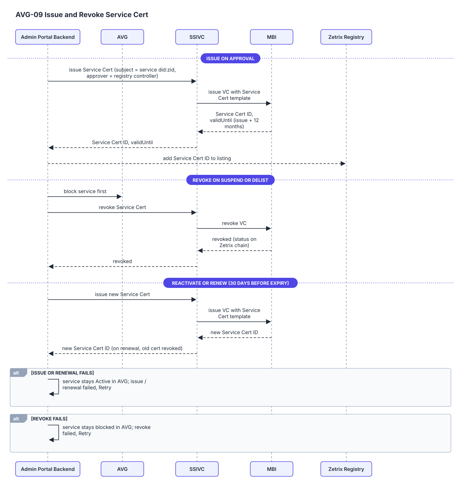
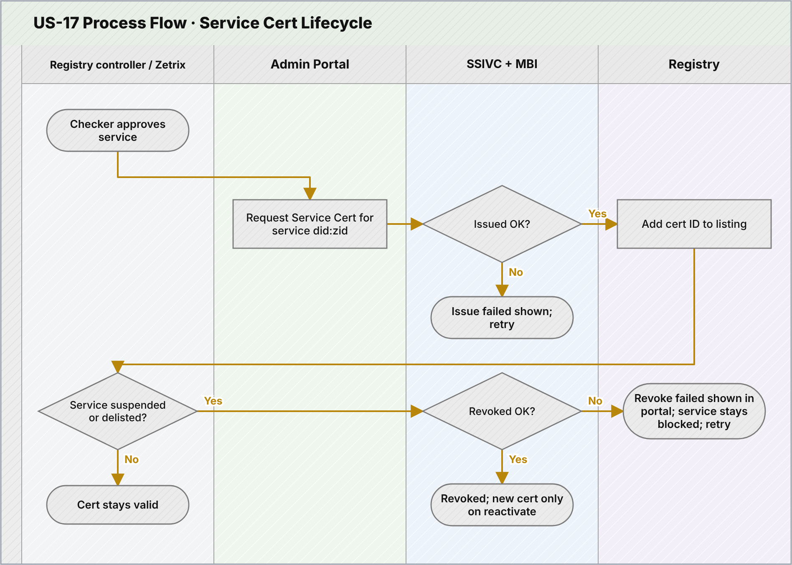

# Service Cert

When a registry controller approves a service, MBI issues it a Service Cert: a did:zid VC that links to the service's did:oan and names the registry controller as approver. Suspend or delist revokes it. This gives services a verifiable identity now, so a later phase can let agents check services before sharing data.


Agents verifying a service's Service Cert is **not** in Phase 1.


## **Business Rules**

| Rule | Detail |
| --- | --- |
| Issuer | MBI issues the Service Cert. The Admin Portal backend does not call MBI directly: it asks SSIVC, and SSIVC calls MBI. The backend authenticates to SSIVC with a service-to-service credential kept in the Zetrix key store. |
| DID vs cert | The service keeps its did:zid when its cert is revoked and a new one is issued. |
| Content | Service did:zid (subject) and did:oan, service name, endpoint domain, service type, registry controller name (approver), approval date, `validUntil`. |
| Approver visibility | The approver name is shown in the portal to Zetrix users only. |
| Idempotent | A retried issue or revoke call never creates a second cert. |

## **Lifecycle**

| Event | Action |
| --- | --- |
| Approve | Issue a Service Cert. |
| Update (name or endpoint domain changed) | Issue a new cert; revoke the old one. |
| Suspend | Revoke the cert at the same time AVG starts rejecting the service. API keys kept. Revoked status written to the Zetrix chain. |
| Reactivate | Issue a new cert with a new ID. The old cert stays revoked; revoked certs are never restored. |
| Delist | Revoke the cert. API keys also revoked. |
| 30 days before expiry (Active) | Daily job asks SSIVC for a new cert; the old one is revoked once the new one is issued. |

## **Validity**

`validUntil` = issue date + 12 months. A Service Cert is valid only when it is not past expiry, not revoked on the Zetrix chain, and issued by the Zetrix issuer through MBI.

## **Failure Handling**

| Failure | Behaviour |
| --- | --- |
| Issue fails | Service still Active in AVG; cert status "issue failed" with Retry. |
| Revoke fails | Service stays suspended / delisted in AVG (calls still rejected); cert status "revoke failed" with Retry. |
| Renewal fails | Portal shows "renewal failed" with Retry. |

**Sequence Diagram**

<figure><figcaption>
Issue and revoke Service Cert for approved services
</figcaption></figure>

<figure><figcaption>
Process flow: Service Cert
</figcaption></figure>
