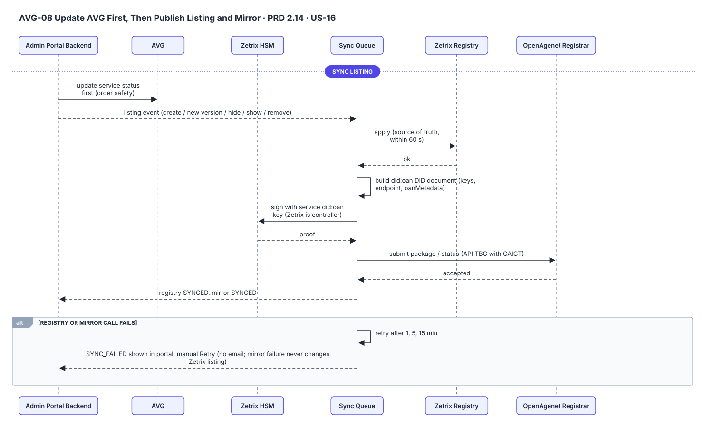

# Zetrix Registry and OpenAgenet Mirror

Zetrix runs its own independent registry. It is the source of truth for which services are approved and active. Each listing is mirrored to OpenAgenet (CAICT) so agents on OpenAgenet can find Zetrix-onboarded services. Agents search the Zetrix registry in Phase 1.

## **Business Rules**

| Rule | Detail |
| --- | --- |
| Source of truth | The Zetrix registry decides what is listed. The OpenAgenet mirror follows it, never the other way round. A mirror failure never blocks or changes the Zetrix listing. |
| Service DID keys | Zetrix signs the service's OpenAgenet listing, and every update, with the did:oan key in the HSM. The service cannot change its listing directly; changes go through the Zetrix Registry Admin. |
| New version on change | OpenAgenet freezes a submitted package, so every approved update is sent as a new package version with the higher service version. |
| Async with retry | Both calls run in the background. Retry after 1, 5 and 15 minutes, then status `SYNC_FAILED` shown in the portal with manual Retry (Super Admin). No email alert. |
| Separate statuses | The Zetrix registry and the mirror have separate sync statuses. |
| Order safety | For suspend and delist, AVG and the Service Cert are updated first. |
| Target time | The Zetrix registry is updated within 60 seconds. |

## **Triggers**

| Zetrix Registry Admin event | Zetrix registry | OpenAgenet mirror | OpenAgenet status |
| --- | --- | --- | --- |
| Approve | Create listing | Create | `active` |
| Edit of public details | Update | New package version | — |
| Suspend | Hide | Hide | `suspended` |
| Reactivate | Show | Show | `active` |
| Delist | Remove | Remove; did:oan deactivated | `revoked` |

## **Listing Content**

| Field | Description |
| --- | --- |
| Service did:zid and did:oan | Identifiers. |
| Service name, type, endpoint, description | From the approved application. |
| Required credential and requested claims | What the service asks agents for. |
| Registry controller | Who vouches for the service. |
| Service Cert ID | Current Service Cert. |
| AVG URL | Where agents submit VPs for this service. Set by Zetrix; Phase 1: the Zetrix AVG URL. |

**Sequence Diagram**

<figure><figcaption>
Publish service listing in Zetrix registry and mirror to OpenAgenet
</figcaption></figure>
